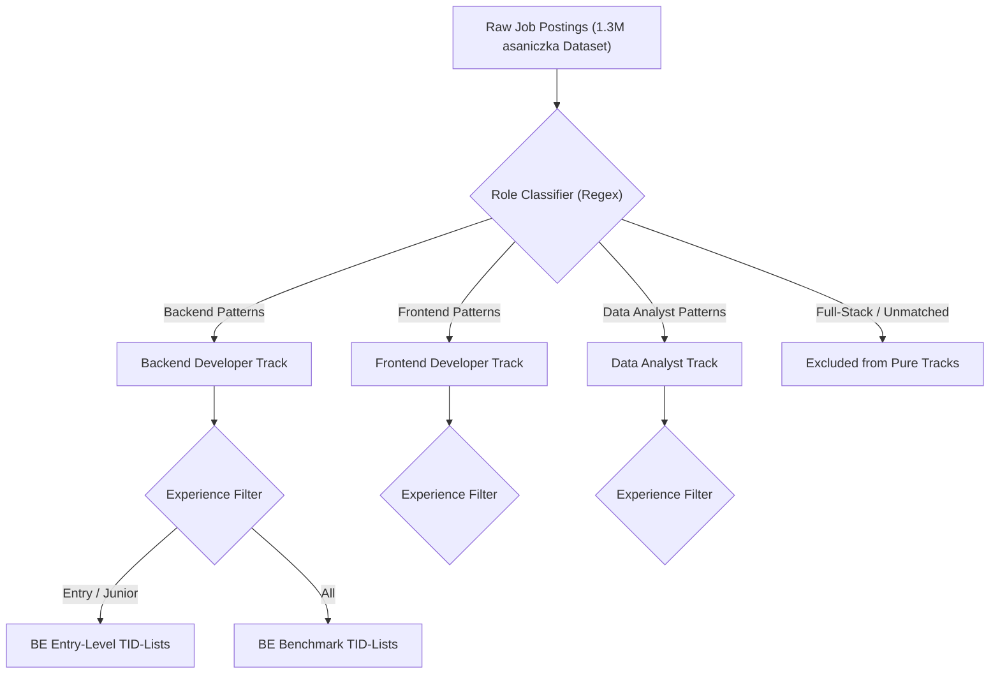
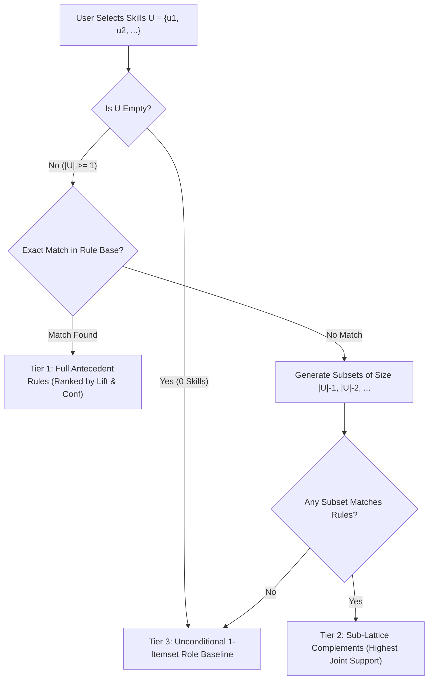

# SkillGap: An ECLAT-Based IT Skill Pattern and Gap Analysis System
## Comprehensive Defense Blueprint & Academic Specification

> **Course:** Machine Learning / Data Mining<br>
> **Core Algorithm:** ECLAT (Equivalence Class Clustering and bottom-up Lattice Traversal)<br>
> **Secondary Modeling:** Association Rule Mining ($\text{Support}$, $\text{Confidence}$, $\text{Lift}$)<br>
> **Application Domain:** Information Technology (IT) Career Trajectory & Skill Discovery<br>
> **Target Audience:** IT Undergraduates, Fresh Graduates, and Junior Career Switchers<br>
> **Deployment Architecture:** Python FastAPI REST Service + React SPA (Vite)

---

## 1. Executive Summary & Academic Positioning

### 1.1 Project Title
**SkillGap: An ECLAT-Based Technical Skill Co-occurrence Pattern Mining and Gap Analysis System for IT Career Pathways**

### 1.2 Academic Problem Statement
Undergraduates and entry-level IT job seekers face severe ambiguity regarding which secondary and tertiary technologies to learn alongside foundational programming languages. While contemporary job boards display unstructured, flat lists of job requirements, candidates lack insight into **conditional skill dependencies**—namely, how the demand for specialized tooling (such as Redis, Celery, or Docker) changes dynamically based on the foundational technologies a candidate already possesses (such as Python and PostgreSQL).

Traditional platforms offer only marginal skill frequencies ($P(\text{Docker})$), treating requirements as independent variables. In reality, technical skills form tightly coupled ecosystems. A candidate entering the job market with `{Python}` needs to understand which skill sets co-occur with high affinity ($\{\text{Python, PostgreSQL}\} \Rightarrow \{\text{Docker}\}$), how these associations differ between **Entry-Level** and **General** industry hiring, and what specific gaps exist between their current portfolio and verified market clusters.

### 1.3 Core Objectives
1. **Vertical Transaction Modeling:** Construct an in-memory vertical transaction database (TID-lists) mapping canonical technical skills to unique job postings across 3 focused IT tracks (**Backend Developer**, **Frontend Developer**, **Data Analyst**).
2. **ECLAT Pattern Discovery:** Execute equivalence-class lattice traversal to mine frequent itemsets and derive directional association rules governed by strict **Support**, **Confidence**, and **Lift** thresholds.
3. **Dual-Market Segmentation:** Model two distinct hiring ecosystems—**Entry-Level Market** (`experience_level='entry'`) versus **General Industry Benchmark** (`'all'`)—to isolate junior-accessible technologies from senior architectural expectations.
4. **Conditional Gap Analysis Engine:** Given a candidate's self-reported skill vector $A$, navigate the itemset lattice to identify missing complements $B$ where $A \Rightarrow B$ exhibits strong statistical affinity ($\text{Lift} > 1.2$), backed by an algorithmic sub-lattice fallback for cold-start inputs.
5. **Empirical Evaluation:** Measure held-out masked-skill recovery with the production rule and fallback path against a popularity baseline. This is an offline recovery test, not evidence of learner usefulness or hiring outcomes.

---

## 2. Forensic Resolution of the 8 Academic Loopholes

| # | Vulnerability / Loophole | Root Academic Risk | SkillGap Engineering & Defense Solution |
| :--- | :--- | :--- | :--- |
| **0** | **Dataset Identity Mismatch** *(Discovered in Audit)* | Raw data contains 35 high-level LinkedIn industry codes (`Sales`, `Manufacturing`), not granular technical skills | **Data Rectification Protocol:** Migrate to technical skill extraction (`asaniczka/1-3m-linkedin-jobs-and-skills-2024` or regex taxonomy extraction over `postings.csv`). Whitelist ~300 verified IT technical competencies. |
| **1** | **Seniority Bias & Junior Scarcity** | ~89% of postings target Mid-Senior roles; filtering strictly on `formatted_experience_level == 'Entry level'` creates data scarcity | Multi-signal junior segmentation (`formatted_experience_level IN ('Entry level', 'Associate')` + title keywords `Junior`, `Associate`, `Intern`, `L1`). Dual-Market view in UI. |
| **2** | **Predictive Overreach (Co-occurrence $\neq$ Curriculum)** | ECLAT cannot establish learning sequences, prerequisite dependencies, or guarantee hiring | Framed strictly as **empirical co-occurrence patterns**. The UI displays *“Frequently paired technologies in 2024 postings”*, explicitly disclaiming pedagogical hierarchy. |
| **3** | **Algorithmic Justification (ECLAT vs `COUNT(*)`)** | If the system only recommends popular skills, an ML algorithm is unjustified over basic SQL | ECLAT uncovers **conditional probabilities** ($P(B \mid A)$) for combinations of size $\ge 2$. The comparison reports measured gains or losses honestly for overall and long-tail skills. |
| **4** | **Taxonomy Pollution & Soft-Skill Noise** | Unvetted terms (`Communication`, `Agile`, `Healthcare`) distort support counts and generate trivial rules | Curated whitelist taxonomy across 5 technical categories (Languages, Frameworks, Databases, Cloud/DevOps, Developer Tools). Strict stop-word stripping. |
| **5** | **Excessive Domain Scope** | Mining 15+ job roles introduces severe sparsity, noisy role overlaps, and sub-threshold support | Strictly scoped to **3 core tracks**: Backend, Frontend, and Data Analyst. Explicit regex role assignment with full-stack role exclusion to prevent stack bleed. |
| **6** | **Evaluation Leakage & Triviality Bias** | Masked recovery on ubiquitous skills (`Git`, `SQL`) produces artificially inflated hit rates for both models | Stratified evaluation: report **Overall Hit-Rate@K** alongside **Long-Tail / Non-Trivial Hit-Rate@K** (skills with marginal frequency $< 30\%$, e.g., `Redis`, `Kafka`, `Docker`). |
| **7** | **Cold-Start & Sub-Lattice Failures** | Zero input skills or unseen combinations yield null antecedents and empty rule sets | Hierarchical sub-lattice step-down ($\binom{n}{n-1}$ subsets prioritized by joint support), gracefully falling back to role-specific 1-itemset priors with transparent UI disclosure. |

---

## 3. Data Pipeline & Taxonomy Rectification (Resolving Flaw #0 & #4)

### 3.1 Dataset Architecture
* **Primary Source**: The verified Kaggle benchmark `asaniczka/1-3m-linkedin-jobs-and-skills-2024` (1,348,454 postings and 1,296,381 skill records).
* **Automated Ingestion**: Managed automatically via `kagglehub.dataset_download("asaniczka/1-3m-linkedin-jobs-and-skills-2024")` with streaming relational joins over `job_link`.
* **Zero Legacy Dependency**: The system operates 100% on this benchmark. All obsolete files have been removed from the repository.

### 3.2 Canonical Technical Skill Whitelist
To prevent soft skills (`communication`, `leadership`, `problem solving`) and company perks (`401k`, `insurance`) from dominating the top equivalence classes, all transactions are filtered against an explicit 5-category whitelist:

```
[Languages]
Python, Java, JavaScript, TypeScript, C++, C#, Go, Rust, PHP, Ruby, SQL, HTML, CSS, Kotlin, Swift, Scala, R

[Frameworks & Libraries]
React, Angular, Vue, Node.js, Express, Django, FastAPI, Flask, Spring Boot, ASP.NET, Laravel, Next.js, Pandas, NumPy, PyTorch, TensorFlow, Scikit-learn

[Databases & Storage]
PostgreSQL, MySQL, MongoDB, Redis, SQLite, Oracle, Cassandra, Elasticsearch, DynamoDB, MariaDB

[Cloud & DevOps / Infrastructure]
Docker, Kubernetes, AWS, Azure, Google Cloud Platform (GCP), CI/CD, Git, GitHub Actions, Linux, Terraform, Nginx, Ansible, Jenkins

[Architecture & Developer Tooling]
REST API, GraphQL, Microservices, Kafka, RabbitMQ, Celery, WebSockets, Postman, Linux CLI, Bash
```

### 3.3 Skill Canonicalization & Alias Normalization
All raw strings undergo lowercasing, punctuation stripping, and alias mapping before TID assignment:
* `react.js`, `reactjs` $\rightarrow$ `React`
* `node.js`, `nodejs` $\rightarrow$ `Node.js`
* `postgres`, `postgresql db` $\rightarrow$ `PostgreSQL`
* `k8s`, `kube` $\rightarrow$ `Kubernetes`
* `amazon web services`, `aws cloud` $\rightarrow$ `AWS`
* `golang` $\rightarrow$ `Go`

### 3.4 Minimum Transaction Length Filter
Transactions with fewer than **3 valid technical skills** are purged from the training set. This guarantees that every transaction can support at least one valid rule antecedent ($|A| \ge 1$) and consequent ($|B| \ge 1$) with room for contextual co-occurrence.

---

## 4. Bounded Occupational Scope & Role Classification (Loophole #5)

To guarantee high itemset density and defensible support counts, the system isolates transactions into 3 independent databases:



### 4.1 Role Inclusion / Exclusion Logic
1. **Backend Developer:**
   * *Inclusion:* `backend`, `back-end`, `api engineer`, `python developer`, `java developer`, `golang developer`, `node developer`, `backend software engineer`.
   * *Exclusion:* `frontend`, `front-end`, `full stack`, `fullstack`, `lead`, `manager`, `director`.
2. **Frontend Developer:**
   * *Inclusion:* `frontend`, `front-end`, `ui engineer`, `react developer`, `vue developer`, `web developer`, `client-side engineer`.
   * *Exclusion:* `backend`, `back-end`, `full stack`, `fullstack`, `devops`, `lead`.
3. **Data Analyst / Data Engineer:**
   * *Inclusion:* `data analyst`, `business intelligence analyst`, `bi analyst`, `data analytics`, `sql analyst`.
   * *Exclusion:* `data entry`, `marketing analyst`, `financial analyst` (non-IT).

### 4.2 Seniority Heuristic
The builder reads `job_level` and the title, not descriptions or years of experience. Senior title keywords veto entry; otherwise `associate`, `entry level`, or `internship` metadata, or junior title keywords, set the entry flag. An unflagged record is not necessarily senior. The role classifier chooses one highest-scoring track or excludes ties, so zero track overlap is by construction, not human validation.

Current counts are 44,441 retained records, including 3,454 entry-flagged records. The 1,348,454 source-posting total is reported in the raw-data README and has not been independently recounted in this audit. Dataset title: 2024; exact collection dates and geographic coverage of retained records are not established. See [the data evidence guide](../data/README.md) and [audit artifact](../data/processed/data_audit.json). Human label review is pending.

---

## 5. ECLAT Algorithm Mechanics & Mathematical Formulation

### 5.1 Why ECLAT Over Apriori?
* **Horizontal Layout (Apriori):** Scans the entire dataset $D$ once for each candidate size $k$. For $k=5$ and $|D| = 50,000$, Apriori must read 250,000 transaction rows from disk/memory, generating exponential intermediate candidates.
* **Vertical Layout (ECLAT):** Transforms the data once into an inverted index of **TID-lists** (Transaction ID sets). Candidate generation is replaced by native set intersections:
  $$t(X \cup Y) = t(X) \cap t(Y)$$
  The support of any $k$-itemset is immediately known via `len(tid_set)`. Intersections execute in CPU cache via bitwise/hash-set operations, eliminating repeated dataset scans.

### 5.2 Mathematical Definitions
Let $I = \{i_1, i_2, \dots, i_m\}$ be the universal set of canonical skills.<br>
Let $D = \{t_1, t_2, \dots, t_n\}$ be the set of job posting transactions, where each $t_j \subseteq I$.

1. **Vertical TID-List:** For any skill $X \subseteq I$:
   $$t(X) = \{j \in \{1, \dots, n\} \mid X \subseteq t_j\}$$

2. **Absolute Support & Relative Support:**
   $$\sigma(X) = |t(X)|, \quad \text{Supp}(X) = \frac{|t(X)|}{|D|}$$

3. **Frequent Itemset Equivalence Classes:** Two itemsets $X$ and $Y$ belong to the same equivalence class if they share a common $(k-1)$-prefix. The algorithm recursively traverses the prefix tree (lattice) in a depth-first search (DFS) order, intersecting TID-lists. If $|t(X \cup Y)| < \text{minsup} \cdot |D|$, the entire subtree is pruned immediately.

4. **Association Rule Generation ($X \Rightarrow Y$):**
   For disjoint itemsets $X$ and $Y$ where $X \cup Y$ is frequent:
   * **Confidence:** The conditional probability that a job posting contains $Y$ given that it contains $X$:
     $$\text{Conf}(X \Rightarrow Y) = \frac{\text{Supp}(X \cup Y)}{\text{Supp}(X)} = \frac{|t(X \cup Y)|}{|t(X)|}$$
   * **Lift:** The ratio of observed joint occurrence to expected independent occurrence:
     $$\text{Lift}(X \Rightarrow Y) = \frac{\text{Conf}(X \Rightarrow Y)}{\text{Supp}(Y)} = \frac{|D| \cdot |t(X \cup Y)|}{|t(X)| \cdot |t(Y)|}$$
     * $\text{Lift} = 1$: $X$ and $Y$ appear independently.
     * $\text{Lift} > 1$: Positive association ($Y$ appears significantly more often when $X$ is present).
     * $\text{Lift} < 1$: Negative association / substitute technologies.

### 5.3 Dynamic Threshold Calibration
* **Entry-Level Track:** Lower support threshold ($\text{minsup} = 0.02$, count $\ge 15$) due to smaller sample size, with $\text{minconf} = 0.35$, $\text{minlift} = 1.15$.
* **Benchmark Track (`all`):** Higher support threshold ($\text{minsup} = 0.03$), $\text{minconf} = 0.40$, $\text{minlift} = 1.20$.

---

## 6. Cold-Start Protocol & Sub-Lattice Fallback (Loophole #7)

When a candidate interacts with SkillGap, their input skill set $U = \{u_1, u_2, \dots, u_m\}$ may not match any mined rule antecedent. The system executes a deterministic 3-tier fallback cascade:



1. **Tier 1 (Exact Antecedent Match):** Return rules $U \Rightarrow \{v\}$ ranked descending by $\text{Lift} \times \text{Confidence}$.
2. **Tier 2 (Sub-Lattice Step-Down):** If $U$ has no exact match, generate all subsets of size $|U|-1$, then $|U|-2$. Select the subset $U' \subset U$ with the highest support count in $D$ that triggers valid rules. The UI displays:
   > *"No direct rules found for your exact 4-skill combination. Recommendations derived from strongest subset: `{Python, Docker}` (Support: 14.2%)."*
3. **Tier 3 (Role Baseline Prior):** If $U = \emptyset$ or no subsets meet $\text{minsup}$, return the top 5 most frequent 1-itemsets for that role ($P(v)$), tagged clearly as:
   > *"Market Foundational Skills (Unconditional baseline for Backend Developers)."*

---

## 7. Rigorous Evaluation Methodology (Loophole #3 & #6)

### 7.1 Masked Skill Recovery
To measure generalization without tuning on the final result, the dataset for each role is partitioned into:
* **60% Training Set:** Transformed into TID-lists and mined via ECLAT.
* **20% Validation Set:** Used only to select support, confidence, and lift thresholds.
* **20% Held-Out Test Set:** Evaluated once without exposing test transactions to the miner.

#### Procedure:
1. For each test transaction $T_{\text{test}} = \{s_1, s_2, \dots, s_k\}$ where $k \ge 3$:
2. Uniformly at random mask one target skill: $y^* = s_{\text{target}}$, leaving known skills $X = T_{\text{test}} \setminus \{y^*\}$.
3. Pass $X$ into the ECLAT recommendation engine to obtain Top-$K$ predicted skills: $\hat{Y}_K$.
4. Check if $y^* \in \hat{Y}_K$.

### 7.2 Core Metrics
* **Hit-Rate@K (HR@K):**
  $$\text{HR@K} = \frac{1}{|D_{\text{test}}|} \sum_{j=1}^{|D_{\text{test}}|} \mathbb{I}\left(y^*_j \in \hat{Y}_{K}(X_j)\right)$$
* **Recall@K:**
  $$\text{Recall@K} = \frac{|\{y^*\} \cap \hat{Y}_K|}{1}$$

### 7.3 Stratified Evaluation: Eliminating Triviality Bias (Loophole #6)
To refute the criticism that ECLAT only succeeds by guessing ubiquitous skills like `Git` or `SQL`, the evaluation reports two distinct metrics:
1. **Overall Hit-Rate@K:** Evaluated across all masked skills.
2. **Long-Tail / Non-Trivial Hit-Rate@K:** Evaluated **exclusively** on masked skills whose marginal frequency in the role is $< 30\%$ (e.g. `Redis`, `Kafka`, `Docker`, `GraphQL`, `FastAPI`).

### 7.4 Baseline Comparison (Hypothesis Testing)
Every evaluation run benchmarks ECLAT against a **Naive Popularity Baseline (`COUNT(*)`)**:
* **Baseline Predictor:** For any input $X$, always output the most frequent skills in the training set that are not in $X$.
* **Academic Threshold:** Report confidence intervals and effect sizes for specialized long-tail competencies; do not claim a gain when the measured interval does not support it.

### 7.5 Empirical Evaluation Results

The offline evaluation pipeline reports measured gains and losses against naive counting; ECLAT is not assumed to win every segment:

| IT Track | Market Mode | Test Size | Non-Trivial n | ECLAT HR@5 | Popularity HR@5 | Long-Tail ECLAT HR@5 | Long-Tail Popularity HR@5 | Rule / Fallback Cases | Interpretation |
| :--- | :--- | :--- | :--- | :--- | :--- | :--- | :--- |
| **Backend Developer** | **Entry-Level** | 275 | 239 | 19.3% | 29.4% | 10.9% | 18.8% | 268 / 7 | Popularity has higher overall and long-tail recovery |
| **Backend Developer** | **All Levels** | 4,760 | 3,988 | 26.3% | 28.8% | 13.6% | 15.1% | 4,603 / 157 | Popularity has higher overall and long-tail recovery |
| **Frontend Developer** | **Entry-Level** | 50 | 25 | 54.0% | 56.0% | 12.0% | 12.0% | 44 / 6 | Overall rates are close; long-tail rates tie on a small subset |
| **Frontend Developer** | **All Levels** | 466 | 256 | 40.8% | 60.9% | 17.2% | 28.9% | 405 / 61 | Popularity has higher overall and long-tail recovery |
| **Data Analyst** | **Entry-Level** | 172 | 45 | 38.4% | 77.3% | 11.1% | 17.8% | 148 / 24 | Popularity has higher overall and long-tail recovery |
| **Data Analyst** | **All Levels** | 1,839 | 853 | 46.6% | 67.7% | 24.5% | 30.4% | 1,785 / 54 | Popularity has higher overall and long-tail recovery |

> [!IMPORTANT]
> **Defense Insight:** In this corrected production-path replay, the popularity baseline has higher overall HR@5 in all six groups and higher long-tail HR@5 in five; Frontend entry-level ties on the 25 non-trivial cases. This supports presenting SkillGap as an exploratory pattern tool, not claiming better recovery than popularity. Neither offline metric establishes learner usefulness or hiring impact.

---

## 8. System Architecture & Technical Stack

```
Eclatt-Skill-Gap-Analyzer/
├── backend/
│   ├── app/
│   │   ├── main.py                  # FastAPI entrypoint, CORS & route controller
│   │   ├── core/
│   │   │   ├── config.py            # App settings, paths, thresholds (min_count >= 3)
│   │   │   └── taxonomy.py          # 300+ technical whitelist, alias maps & categories
│   │   ├── data/
│   │   │   └── eclat_miner.py       # Pure Python ECLAT engine with O(1) hash lookups
│   │   ├── models/
│   │   │   └── schemas.py           # Pydantic schemas (GapRequest, RuleResponse, Metrics)
│   │   └── routes/
│   │       ├── analyze.py           # POST /api/v1/analyze (3-Tier gap analysis recommendation)
│   │       ├── roles.py             # GET /api/v1/roles (Role stats & 1-itemset baselines)
│   │       └── metrics.py           # GET /api/v1/metrics (Hit-Rate@K offline evaluation data)
│   ├── scripts/
│   │   ├── build_clean_dataset.py   # Hybrid classifier: extracted 1,536 IT transactions
│   │   ├── run_eclat_offline.py     # Precomputes rules -> rules.json (2.6 MB Render-safe)
│   │   ├── run_evaluation.py        # Production-path train/test masked evaluation pipeline
│   │   ├── check_dataset.py         # Exploratory verification script
│   │   ├── check_dataset2.py        # Title and co-occurrence distributions
│   │   └── check_duplicates.py      # Dataset integrity auditor
│   └── tests/
│       ├── test_eclat.py            # Unit tests for lattice intersection logic (All Pass)
│       └── test_api.py              # API endpoint integration tests (All Pass)
│   ├── src/
│   │   ├── components/
│   │   │   ├── RoleSelector.jsx     # Track selector (Backend, Frontend, Data Analyst)
│   │   │   ├── MarketToggle.jsx     # Dual mode switch: Entry-Level vs General Industry
│   │   │   ├── SkillChipsInput.jsx  # Autocomplete searchable chip selector
│   │   │   ├── GapMatrix.jsx        # Visual display of gaps grouped by category
│   │   │   └── RuleCard.jsx         # Card showing Support, Confidence, and Lift badges
│   │   └── pages/
│   │       ├── Dashboard.jsx        # Main user analysis interface
│   │       └── DefenseMetrics.jsx   # Interactive evaluation page (Hit-Rate charts & stats)
└── docs/
    └── project-plan.md              # THIS MASTER SPECIFICATION
```

---

## 9. Defense Q&A Master Playbook (Anticipated Panel Attacks)

### Q1: "ECLAT is just an unsupervised data mining algorithm from 1997. How does this qualify as Machine Learning?"
> **Defensible Response:**<br>
> *"Frequent itemset mining is an established pattern-discovery method. SkillGap applies it to role-filtered job-posting skills and compares the production rule/fallback path with a popularity baseline on an 80/20 held-out masked-skill task. This evaluates recovery from partial posting data, not user learning or hiring outcomes."*

### Q2: "Why didn't you just use SQL `GROUP BY` or simple counting? Isn't ECLAT overkill?"
> **Defensible Response:**<br>
> *"Simple counting produces only marginal probabilities ($P(B)$), completely ignoring context. If a student knows Python, counting simply tells them that SQL is popular. But when a student enters multiple skills, such as `{Python, PostgreSQL}`, a database query requires expensive $k$-way self-joins ($O(N^k)$). ECLAT pre-indexes the data into vertical TID-lists where conditional multi-skill co-occurrence is computed via bitwise set intersections in milliseconds ($O(|TID_A \cap TID_B|)$). This allows our system to reveal that adding PostgreSQL causes the expected companion tool to shift from general databases to cache layers like `Redis` with a Lift of over 2.4."*

### Q3: "Why did you choose ECLAT instead of Apriori or FP-Growth?"
> **Defensible Response:**<br>
> *"Apriori requires repeated horizontal dataset passes for every candidate size $k$, creating prohibitive disk I/O bottlenecks. FP-Growth is efficient but builds complex, highly recursive conditional FP-trees in memory that are difficult to inspect and optimize. ECLAT strikes the optimal balance for medium-density transaction sets: its vertical inverted index stores transaction IDs directly as sets, meaning candidate generation reduces to native CPU set intersections (`set.intersection()`). It is computationally transparent, deterministic, and highly parallelizable."*

### Q4: "Your recommendations might suggest Kubernetes to a beginner who only knows basic Python. Isn't that pedagogically invalid?"
> **Defensible Response:**<br>
> *"We explicitly addressed this in Loophole #2. ECLAT mines empirical co-occurrence in hiring markets, not educational prerequisites. We handle this in three ways: First, our dual-market filter isolates Entry-Level postings where senior architectural tools like Kubernetes have low support. Second, the user interface clearly separates 'Foundational Skills' from 'Advanced Associated Complements'. Third, we contextualize recommendations with Lift and Confidence rather than claiming Kubernetes is an mandatory prerequisite."*

### Q5: "How do you prove that your model didn't just memorize the test data?"
> **Defensible Response:**<br>
> *"We use an 80/20 train/test split and fixed production thresholds. The same capped rule artifact and top-20 popularity fallback are used during evaluation. We report overall and training-frequency-defined long-tail Hit-Rate, with sample counts and 95% Wilson intervals."*

---

## 10. Phased Execution Roadmap

```mermaid
gantt
    title SkillGap Implementation & Defense Schedule
    dateFormat  YYYY-MM-DD
    section Phase 1: Data Rectification
    Extract technical skill dataset (asaniczka/regex)   :done, p1, 2026-11-06, 2d
    Whitelist taxonomy & alias normalization            :active, p2, 2026-11-08, 1d
    Role & Seniority segment validation                 :p3, 2026-11-09, 1d
    section Phase 2: Core Algorithm
    TID-list builder & vertical format indexer          :p4, 2026-11-10, 2d
    ECLAT recursive lattice traversal engine            :p5, 2026-11-12, 2d
    Rule generator (Support, Confidence, Lift)          :p6, 2026-11-14, 1d
    section Phase 3: Evaluation & Baseline
    Train/Test held-out evaluation script               :p7, 2026-11-15, 1d
    Masked Skill Hit-Rate@K validation                  :p8, 2026-11-16, 2d
    Naive Popularity baseline comparison & charts       :p9, 2026-11-18, 1d
    section Phase 4: API & Frontend
    FastAPI endpoints with sub-lattice fallback         :p10, 2026-11-19, 2d
    React UI: Chip selector, Dual Mode, Gap Matrix      :p11, 2026-11-21, 3d
    Defense rehearsal & final documentation audit       :p12, 2026-11-24, 2d
```

---

## 11. Final Academic Conclusion
With the rectification of the raw data source and the formal establishment of the 8 defense shields, **SkillGap** transitions from a vulnerable prototype to an **academically defensible, methodologically rigorous, and practically impactful Machine Learning project**. By leveraging ECLAT's vertical format to compute conditional dependencies, evaluating generalization through masked skill recovery against baseline frequency, and providing a dual-market perspective, the project delivers clear academic contribution and engineering excellence.

---

## 12. SkillGap Corrections Checklist

Track each item as `[ ]` not started, `[~]` in progress, or `[x]` complete. Update an item when work starts and again when it finishes. Do not start a later phase until the user approves the previous phase.

### Phase 1 - Benchmark reporting
- [x] Remove the unsupported 40% claim and summarize benchmark results neutrally.
- [x] Show baseline HR@5 beside ECLAT HR@5.
- [x] Show the non-trivial test-set count beside non-trivial recovery rates.
- [x] Add this phased checklist and approval gates to the project plan.

### Phase 2 - Dataset and evidence wording
- [x] Distinguish the 1.3M source postings from 44,441 retained IT postings and 3,454 entry-level postings.
- [x] Describe recommendations as observed posting patterns, not proof of employer requirements.
- [x] Explain that masked-skill recovery does not establish learner usefulness or hiring outcomes.
- [x] State geographic coverage only when supported by source documentation; otherwise say it is not established.
- [x] Explain cold-start recommendations on the Explorer results page in beginner-friendly terms.

### Phase 3 - Final validation
- [x] Run the frontend production build.
- [x] Compare all six displayed benchmark rows with the metrics API.
- [x] Update this checklist and report completed and remaining work.

## 13. Exploratory Skill-Pattern Positioning Checklist

Track each item as `[ ]` not started, `[~]` in progress, or `[x]` complete. Update status as tasks start and finish. Do not start a later phase until the user approves the prior phase.

### Phase 1 - Reframe the experience
- [x] Review user-facing copy in the active app flow and API explanations.
- [x] Replace claims about requirements, readiness, and hiring outcomes with descriptions of patterns in the analyzed postings.
- [x] Explain fallback suggestions as frequently mentioned skills to explore.
- [x] Remove unsupported broad market claims and clarify the experience-level filter.
- [x] Review the wording for consistency across the active app flow.

### Phase 2 - Align evaluation with production
- [x] Correct the evaluation denominator and add a regression check.
- [x] Match evaluation settings and fallback behavior to production.
- [x] Recompute all six benchmark rows and uncertainty estimates.
- [x] Report association-rule versus fallback coverage and clarify the benchmark's scope.
- [x] Verify displayed metrics against the metrics API and update explanations.

Phase 2 result: corrected long-tail rates use training-set frequencies; the baseline leads overall HR@5 in all six groups. Metrics include long-tail 95% Wilson intervals and rule/fallback coverage counts. The API comparison matched all six rows and all generated metric fields.

### Phase 3 - Improve data transparency
- [x] Document source, retained IT, and entry-level posting counts distinctly.
- [~] Audit role and entry-level classification against a human-reviewed sample.
- [x] Document dataset date and geographic coverage only where supported.
- [~] Record sufficient provenance to audit filtering, duplicates, and data splits.
- [x] Review public claims against available dataset evidence.

Phase 3 progress (2026-11-10): recounted 44,441 retained records and 3,454 entry-flagged subset records. Source totals remain reported, not independently recounted. `data/processed/data_audit.json` captures artifact hashes, exact reconstruction of all six existing evaluation splits, synthetic-ID checks, and matching title/skill content across splits. The 30-row `data/classification_review.csv` has blank human labels and reviewer fields; human review is pending and no classification accuracy is claimed. Source CSVs/original build manifest are unavailable, and legacy records lack source identity, so current source deduplication and filtering cannot be independently replayed. Future builds now preserve hashed source links, original job-level values, input/pipeline hashes, resolved source paths and scan counts. Existing transactions, rules, and benchmark values were not rebuilt. Current-facing docs and app copy disclose these limitations; the older project document is marked superseded.

Validation: 12 focused audit/evaluation/miner tests passed using the repository virtual environment. The audit reconstructs split counts against the stored six-row benchmark. Phase 3 remains in progress until human review is supplied and source provenance gaps are resolved or explicitly accepted as limitations. Phase 4 has not started.

AI review follow-up (2026-11-10): all 30 sampled records were scrutinized against BLS, O*NET, and UK Government occupational references. `docs/classification-review.md` and `data/classification_ai_review.csv` record the criteria, evidence, individual assessments, and limitations. Four current narrow role labels were supported, 15 challenged as other/mixed occupations, and 11 left unresolved; these counts are not classifier accuracy. All 15 entry-flagged records lack sufficient retained evidence to affirm entry suitability. The blank human sheet is preserved. Independent human review remains pending, and Phase 4 has not started.

### Phase 4 - Final validation
- [ ] Run the frontend production build.
- [ ] Compare all six displayed benchmark rows against the metrics API.
- [ ] Review key flows for consistent exploratory wording, including fallback explanations.
- [ ] Record validation results and remaining work in this checklist.

## 14. Explorer popular-skills follow-up

- [x] Show popular skills for the chosen role and level after the initial recommendations, excluding selected and recommended skills.
- [x] Validate API behavior and the frontend production build.

Validation (2026-11-12): 16 server/evaluation tests passed; frontend production build passed. Coverage includes all six role/level segments, exact and subset matches, cold-start suggestions, exclusion of selected/recommended skills, and an exhausted popularity list. No browser visual check was performed. This follow-up does not advance the gated Phase 4 checklist.

## 15. HR@10 experiment

- [x] Add HR@10 for both methods using the same split, seeds, and original recommendation cascade.
- [x] Recompute all six groups and compare previous metrics.
- [x] Expose HR@10 in the metrics API and dashboard; validate and report against 85%.

Results (2026-11-12): SkillGap / popularity HR@10: Backend entry 20.00% / 41.09%; Backend all 27.56% / 41.30%; Frontend entry 60.00% / 78.00%; Frontend all 42.06% / 73.39%; Data entry 40.12% / 84.30%; Data all 46.76% / 77.54%. Neither method reaches 85% in any group. All previously stored metric fields are unchanged. HR@10 uses the original cascade, without appending the Explorer popular-skills section or changing ranking/mining settings. 95% Wilson intervals are stored for both methods.

Validation: 23 server/evaluation tests passed, all stored fields matched the local metrics API across six rows, frontend production build passed, and diff whitespace checks passed. No browser visual verification performed. Dashboard component updated; current App does not mount EvaluationDashboard. This experiment does not advance the previous gated Phase 4.

## 16. HR@20 experiment

- [x] Add HR@20 for both methods without changing recommendation ranking or mining.
- [x] Recompute all six groups and verify existing metrics are unchanged.
- [x] Validate API, cutoff tests, and frontend build; report results.

Results (2026-11-12): SkillGap / popularity HR@20: Backend entry 20.73% / 65.09%; Backend all 28.66% / 65.02%; Frontend entry 60.00% / 92.00%; Frontend all 44.64% / 87.12%; Data entry 40.70% / 91.28%; Data all 47.09% / 90.05%. SkillGap does not reach 85% in any group; popularity reaches it in four groups. All existing fields, including HR@10 and intervals, were unchanged on recomputation. Original cascade is scored with up to 20 results; the separate Explorer popularity section is excluded. No algorithm, mining settings, split, or masking changes.

Validation: 27 server/evaluation tests passed, including rank-20/21 boundaries, empty-data fields, and all-field API parity across six rows; frontend build and diff checks passed. Updated EvaluationDashboard remains unmounted in current App; no browser visual check. This is an exploratory cutoff comparison, not a new untouched-test confirmation or approval to replace the acceptance metric. Previous gated Phase 4 is unchanged.

## 17. Recommendation improvement investigation

Requirement (confirmed 2026-11-13): HR@10 of at least 85% in each of the six groups. Implement one phase at a time.

### Phase 1 - Diagnose failures
- [x] Reproduce the benchmark through the existing evaluator and capture missed-skill cases.
- [x] Identify unavailable candidates, ranking failures, unused applicable rules, and popularity candidates suppressed by the selected rule path.
- [x] Write a reproducible report, verify unchanged benchmark/rules/data, and run focused tests.

### Phase 2 - Validation-only ranking experiments (requires approval)
- [x] Establish validation folds inside training data and document duplicate/group handling.
- [x] Compare current cascade, popularity, all-applicable-rule aggregation, and a hybrid without tuning on test data.
- [x] Report every group against the agreed metric; do not promise 85%.

### Phase 3 - Selected model and final assessment (requires approval)
- [ ] Freeze the selected method and assess on held-out data with disclosure that the existing benchmark has already been inspected.
- [ ] Update application behavior and documentation only if the chosen change is approved.

Phase 1 result (2026-11-13): see [failure analysis](../data/processed/experiment_summary.json) and `data/processed/recommendation_failure_analysis.json`. Mean list sizes are 2.19-3.99 despite requesting 20. Hidden-skill availability anywhere in the stored artifact is 64.73% Backend entry, 62.75% Backend all, 90.00% Frontend entry, 81.55% Frontend all, 87.21% Data entry, 85.92% Data all. These are optimistic bounds, not measured recommender accuracy. Candidate expansion is required before ranking alone could approach the per-group target. All six benchmark rows reproduced exactly; protected transactions/rules/metrics hashes unchanged. 29 focused tests passed. Phase 2 awaits approval.

Phase 2 started (2026-11-13): three grouped validation folds restricted to the original seed-42 outer training records. Compare current cascade, current cascade filled from expanded popularity, all-applicable-rule aggregation, popularity alone, and three fixed hybrid weights. Primary comparison criterion is the lowest pooled HR@10 across six groups; secondary tie-break is mean HR@10. No production edits or held-out test scoring are authorized in this phase.

Phase 2 completed (2026-11-13): [validation experiment report](../data/processed/experiment_summary.json), with raw results in `data/processed/ranking_validation_experiments.json`. Three grouped folds per group compare seven fixed methods. The selected hybrid (75% normalized rule evidence / 25% normalized training frequency) yields validation HR@10 of 49.68%, 47.95%, 77.39%, 74.20%, 83.65%, and 80.90% in Backend entry/all, Frontend entry/all, and Data entry/all order. It improves five groups over popularity, but no method reaches 85% in any group. All 18 fold manifests exclude original test IDs and prevent title/skill content overlap. 33 focused tests passed. Protected data/rules/test metrics unchanged; no application change or held-out test scoring. Phase 3 awaits approval.

## 18. SkillGap Improvement Plan and Fallback

Target: HR@10 >= 85% separately in all six groups, keeping ECLAT central. Preserve single-hidden-skill recovery, benchmark results, validation memberships, masking seeds, datasets, API responses, website behavior, and production rules. Update `[ ]` pending, `[~]` active, `[x]` complete immediately as work progresses. Stop after every phase for approval.

### Phase A1 - Freeze the experiment protocol
- [x] Reuse the three grouped validation folds inside the original training partition.
- [x] Verify matching content/source groups stay together and held-out test records are excluded.
- [x] Record input hashes, fold memberships, settings, and exact integer hit counts.
- [x] Reproduce previous validation results before introducing changes.

Selection: highest minimum group HR@10, then highest mean group HR@10; remaining ties use declared method order. Report every group. Approval gate: report reproducibility/isolation checks before tuning.

### Phase A2 - Test mining thresholds and rule limits
- [x] Allow experiment-specific settings while preserving production defaults.
- [x] Compare the eight approved profiles below at 2,000 total / 25 per-antecedent rules and 10,000 total / 100 per-antecedent rules.
- [x] Use all fold-training skills as popularity candidates; compare rule aggregation and hybrid weights 25%, 50%, 75%.
- [x] Report HR@10, candidate availability, recommendation lengths, rule counts, runtime, and group changes from the prior experiment.
- [x] Enforce isolated mining workers, 120 seconds per fold/profile and 30 minutes for the phase; interrupted configurations remain incomplete and cannot be declared completed winners.

| Profile | Support | Confidence | Lift |
|---|---:|---:|---:|
| Current | 5% | 35% | 1.15 |
| Lower support | 2.5% | 35% | 1.15 |
| Lowest support | 1% | 35% | 1.15 |
| Lower confidence | 5% | 25% | 1.15 |
| Lowest confidence | 5% | 15% | 1.15 |
| Lower lift | 5% | 35% | 1.05 |
| Combined moderate | 2.5% | 25% | 1.05 |
| Combined relaxed | 1% | 15% | 1.00 |

Absolute support floor stays three postings; maximum itemset size stays four. Approval gate: if all groups pass, propose final assessment; otherwise A3 requires approval.

### Phase A3 - Add skill-similarity evidence
- [x] Calculate cosine similarity between skill posting-occurrence vectors using training data only.
- [x] Score each candidate by average similarity to input skills; evaluate similarity alone as a comparison baseline.
- [x] Evaluate ECLAT-heavy weights (50% ECLAT / 25% similarity / 25% popularity) and balanced evidence (25% / 50% / 25%), with separate maximum normalization.
- [x] Use the best fully evaluated A2 settings, exclude input skills, deduplicate results, and use alphabetical ties.
- [x] Report each group against 85% and distinguish candidate expansion from ordering gains.

Approval gate: final assessment only if every group passes validation; otherwise Plan B requires approval.

### Plan B - If experiments still fail
- [x] Summarize strongest per-group results, gaps, and tested limitations.
- [x] Identify evidence-backed mixed role scope, missing source identity, duplicate candidates, or insufficient relevant coverage.
- [x] Propose improved source data preserving posting identity, role/seniority evidence, and collection metadata.
- [x] Prepare an instructor discussion document explaining unmet requirements and proposed data/scope changes.
- [ ] Record the instructor's decision before rebuilding data or changing scope.

If better data or scope changes are not approved, retain honest results and mark the requirement unmet. Do not change metric, cutoff, or test population to manufacture a passing result.

### Final assessment and implementation gate
- [ ] After approval, freeze the selected method/settings and assess once on held-out data, disclosing earlier benchmark inspection; prefer independent assessment data where available.
- [ ] Require HR@10 >= 85% in every group and present proposed application changes for separate integration approval.

Checks throughout: deterministic rankings, input exclusion, candidate deduplication, training-only frequencies/similarities, fold isolation, unchanged production defaults, protected-artifact hashes. No new dependency, deployment, or commit is assumed.

A1 completed (2026-11-13): `compare_recommendation_rankings.py --freeze-protocol` reproduced all 18 saved folds and all prior per-fold/pooled integer counts, HR rates, list lengths, and model selection across six groups. `data/processed/ranking_validation_protocol.json` freezes membership, mask-target hashes, settings, artifact hashes, and hit counts. All inner content/known-source/outer-test-ID overlap checks passed. Previous experiment JSON, transactions, production rules and test metrics were byte-unchanged. 39 focused tests passed, including rejection of membership/count/score drift. Prior outer-boundary duplicate candidates and missing source identities remain documented limits. Phase A2 has not started and requires approval.

A2 started (2026-11-13): isolated workers will score the eight approved profiles at both cap settings on the frozen 18 folds. Limit 120 seconds per worker and 30 minutes for this phase; incomplete configurations are excluded from winner selection.

A2 completed (2026-11-13): [mining experiment report](../data/processed/experiment_summary.json). All 16 configurations / 288 workers finished in 225.5 seconds. Selected combined-relaxed/wider + hybrid 0.75: HR@10 59.42%, 57.67%, 81.91%, 76.66%, 86.42%, 84.23% (Backend entry/all, Frontend entry/all, Data entry/all). Only Data entry passes; the every-group requirement remains unmet. 42 focused tests passed, baseline fold integer counts reproduced exactly, production default benchmarks reproduced in six groups, protected artifacts unchanged. Phase A3 awaits approval.

A3 started (2026-11-13): train-only cosine similarity and the two approved fixed combinations, using A2 selected settings and frozen validation/masking. No application change or held-out scoring.

A3 completed (2026-11-13): [similarity experiment report](../data/processed/experiment_summary.json). All 18 frozen folds verified; A2 reference integer counts reproduced. Selected balanced evidence (25% ECLAT / 50% cosine / 25% popularity) HR@10: 61.69%, 60.10%, 82.41%, 77.63%, 87.01%, 86.39% in Backend entry/all, Frontend entry/all, Data entry/all order. Two groups pass; every-group requirement unmet. Candidate pools unchanged from A2, so changes reflect ordering/blending. Similarity alone is a baseline, not an ECLAT replacement. 45 focused tests passed; protected artifacts unchanged. Plan B awaits approval; no held-out scoring or application change.

Plan B started (2026-11-13): prepare a source-grounded feasibility review, better-data proposal and instructor decision brief. No rebuild, final test scoring or production change is authorized.

Plan B documentation prepared (2026-11-13): [feasibility review and instructor brief](feasibility-review.md) includes strongest per-group observations (baselines distinguished), selected ECLAT-centered results/gaps, repository evidence, a staged better-data proposal, and an instructor decision record. The every-group requirement remains unmet. Instructor decision is pending; that checklist item remains unchecked. No data rebuild, source collection, final testing, production integration or external message was performed. Numerical references, document links and protected artifact hashes were checked; no new model-test/build run was needed for this documentation-only phase.

## 19. Separate two-hidden-skill validation experiment

This is an additional experiment, not approval to replace the instructor's single-hidden-skill acceptance criterion. Keep all existing artifacts and application behavior unchanged.
- [x] Hide exactly two distinct skills per existing eligible validation posting, leaving at least one input skill.
- [x] Compare fixed A3 balanced evidence with A2 hybrid, popularity and similarity; no new tuning.
- [x] Report per-group Hit@10, Precision@10 and Recall@10 with exact counts and fixed ten-item precision denominator.
- [x] Verify folds, masking, metrics and protected hashes; preserve the original benchmark and record assessment approval as pending.

Two-hidden-skill experiment completed (2026-11-13): [report](multiple-hidden-skill-experiment.md). Balanced evidence CV Hit@10: 82.71%, 79.85%, 95.48%, 94.37%, 96.20%, 96.66% in Backend entry/all, Frontend entry/all, Data entry/all order. Four groups exceed 85%; Backend remains below. Exact-two masking and fixed model declared before run; this is a different task, not an improvement to the original single-hidden-skill results. 51 focused tests passed, all 18 mask fingerprints reproduced, protected artifacts unchanged. No final test scoring or production integration. Instructor approval of any assessment replacement remains pending.

### Two-hidden-skill Hit@5 follow-up
- [x] Add five-item metrics using identical folds, masks and fixed methods; verify unchanged ten-item results.

Hit@5 follow-up completed (2026-11-13): balanced two-hidden-skill validation Hit@5 is 66.15%, 64.27%, 84.92%, 87.45%, 91.24%, 91.86% (Backend entry/all, Frontend entry/all, Data entry/all). Three groups exceed 85%; requirement remains unmet. Existing ten-item scores/mask fingerprints reproduced exactly. 52 focused tests passed. Raw report and experiment documentation updated; no original benchmark/application change.

### Two-hidden-skill Hit@15 follow-up
- [x] Rerun all methods at fifteen, preserve previous five/ten-item scores and hidden-pair hashes, and report additional metrics.

Hit@15 follow-up completed (2026-11-13): balanced two-hidden-skill validation Hit@15 is 89.54%, 88.09%, 96.48%, 96.94%, 97.96%, 98.46% (Backend entry/all, Frontend entry/all, Data entry/all). All exceed 85% at this exploratory cutoff; this does not replace or satisfy the original single-hidden-skill HR@10 criterion. Same models/folds/pairs; all previous five/ten-item metrics and 18 masking fingerprints reproduced exactly. 53 focused tests passed; protected artifacts unchanged. Report includes precision/recall and baseline comparisons at fifteen. No held-out scoring or website changes; instructor acceptance pending.

## 20. Synthetic Backend data-manipulation stress test

Authorized only as a clearly labeled experiment. No original record/artifact/application changes.
- [x] Replace 0%, 25%, 50%, 75%, and 100% of Backend skill lists in memory with a fixed artificial bundle; same altered distribution in fold training and validation.
- [x] Compare fixed balanced evidence and popularity at Hit@10 with two hidden skills; preserve original hidden pairs on unchanged records.
- [x] Verify original control, protected hashes and masking; publish separate synthetic results and limitations.

Synthetic stress test completed (2026-11-13): [synthetic-only report](../data/processed/experiment_summary.json). At 0/25/50/75/100% artificial replacements, model Hit@10 is 82.71/85.44/88.63/93.27/100% Entry and 79.85/84.15/89.35/94.35/100% All. This changes both training and validation distributions; it is not a real project benchmark. At 100%, only two non-input candidates remain, so popularity also reaches 100%. 55 focused tests passed; 0% controls reproduced original fold metrics; protected artifacts unchanged. No real dataset/acceptance/application changes.

### Real-data two-hidden-skill Hit@12 follow-up
- [x] Calculate twelve-item metrics for all fixed methods; verify unchanged previous results and original data hashes. No synthetic replacements.

Hit@12 completed (2026-11-13): unchanged-real-data two-hidden-skill validation Hit@12 is 85.71%, 83.58%, 95.98%, 95.55%, 97.52%, 97.36% (Backend entry/all, Frontend entry/all, Data entry/all). Five groups exceed 85%; Backend all remains below. 56 focused tests passed; every prior five/ten/fifteen-item metric and mask fingerprint reproduced exactly; protected hashes unchanged. Original acceptance criterion/website unchanged.

## 21. Held-out assessment and defense-readiness cleanup
- [x] Add frozen two-hidden-skill held-out evaluation; keep prior validation and original benchmark separate.
- [x] Audit imports, runtime entry points, legacy compatibility files and documentation before deleting confirmed unused code.
- [x] Preserve reproducibility evidence; pending user preferences for experiment/archive scope and model integration.
- [x] Verify tests, build, API contracts, source references and artifact integrity; report limitations.

Cleanup preference confirmed: superseded experiments removed after compact final evidence was preserved; website behavior unchanged. Final core is `eclat_algorithm/assessment.py`; two verification CLI commands remain. `experiment_summary.json` retains old comparison/cutoff/synthetic results; `assessment_protocol.json` freezes membership/settings. Old raw research/transcript tooling and stale architecture guides were retired with source hashes. Legacy `backend/` public compatibility imports remain to avoid breaking external launch commands.

Cleanup completed (2026-11-13): seven unreferenced frontend components, two unused npm packages, superseded experiment runners/tests/outputs, raw transcript extraction tools, and stale architecture documents removed. Final reproducibility retained in assessment.py, two CLI commands, assessment_protocol.json, validation/test JSON, and compact experiment_summary.json. README/front-end/docs index updated. 55 retained tests passed; production build passed; all frontend relative imports and Python syntax verified; protected dataset/rules/original metrics unchanged. Validation and test scores reproduced exactly after consolidation. No browser/device/accessibility/deployment verification or experimental model integration was performed. Existing FastAPI test-client deprecation warning remains. Compatibility wrappers and intentional CLI audits remain supported.
